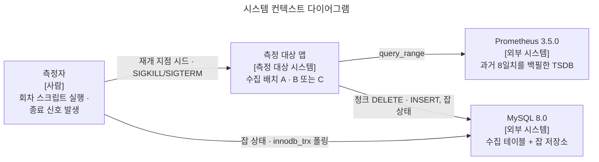

# batch-chunk-recovery-lab

5분 주기 GPU 사용량 수집 배치가 실행 중에 죽거나 긴 범위를 복구할 때, 청크 커밋 · 잡 러너 재시도 · 힙 피크가 어떻게 되는지 재현해 측정한 랩입니다.

## 요약

> 결과는 측정 뒤 이 자리에 채웁니다. 아래 1절의 가설 · 판정 기준은 첫 측정보다 먼저 커밋했습니다.

## 1. 목적

**5분 주기 수집 배치가 실행 중에 죽을 때 무엇이 남는지, 긴 범위를 복구할 때 어디서 메모리가 깨지는지 재현으로 판정하고, 고친 방식과 Spring Batch 를 같은 시험에 올립니다.**

| 질문 | 판정에 쓰는 비교 |
|---|---|
| ① 실행 중 강제 종료 · 정상 종료되면 무엇이 남고 어떻게 이어지는가 | 종료 신호(SIGKILL · SIGTERM) × 신호 시점(조회 중 · 청크 쓰기 중 · 청크 사이), 종료 유예 60초 |
| ② 복구 범위 × 시리즈 수에 따라 힙 피크는 어떻게 늘고, 실효 상한에서 어디서 OOM 이 나는가 **(1순위)** | 범위 1 · 2 · 4 · 7일 × 시리즈 50 · 224 · 448 · 896 |
| ③ 시간 창으로 나눠 「조회 → 커밋 → 워터마크 전진」을 반복하면 피크가 범위와 무관해지는가, 대가는 | 지금 방식(A) ↔ 창 방식(B, 1일 · 6시간 · 1시간 창) |
| ④ Spring Batch 청크 스텝으로 같은 일을 하면 피크와 재시작은 | 창 방식(B) ↔ Spring Batch(C). 읽기 전략이 같고 프레임워크만 다르다 |

### 1.1 비교군

| 기호 | 무엇 |
|---|---|
| A | 지금 방식: 재개 지점~지금 전체를 한 번 조회 → 힙에 행 목록 하나 → 500행 단위 REQUIRES_NEW 저장 (JobRunr 7.5.1 recurring 잡) |
| B | A 에서 조회만 시간 창으로 나눔. 창마다 조회 → 그 창의 행만 저장 → 커밋된 MAX(수집 시각)가 다음 창의 시작 (같은 JobRunr 잡) |
| C | Spring Batch 5.2 청크 스텝. ItemReader 가 B 와 같은 창 단위로 읽고, 아이템 = 수집 시각 하나의 행 묶음, 행 합 500 이상에서 청크를 끊는다. 재시작 상태는 ExecutionContext |

조회 · 행 변환 · 청크 쓰기 문장은 세 비교군이 같은 모듈(`lab-core`)을 씁니다. A ↔ B 는 읽기 단위만, B ↔ C 는 프레임워크만 다릅니다.

「Spring Batch + 전체 범위를 한 번에 읽는 ItemReader」는 메모리가 A 와 같은 메커니즘이라 따로 재지 않습니다.

### 1.2 원 구성에서 옮긴 값

| # | 값 | 랩에서 |
|---|---|---|
| F1 | JVM 에 `-Xmx` · `MaxRAMPercentage` 없음, 컨테이너 메모리 상한 1Gi · CPU 상한 1, G1 명시(`-XX:+UseG1GC -XX:MaxGCPauseMillis=200 -XX:InitiatingHeapOccupancyPercent=45 -XX:ParallelGCThreads=4 -XX:ConcGCThreads=1`) → 실효 최대 힙 1Gi × 25% = 256MB | 상한 모드 기본 256MB. 768MB(`MaxRAMPercentage=75`)는 「수정 제안 수준」으로 함께 잰다 |
| F2 | Spring `RestClient` + `HttpServiceProxyFactory`. 응답을 String 으로 받지 않고 Jackson 이 바로 `record GenericResult(Map<String,String> metric, List<Object> values)` 로 역직렬화 | 같은 경로 |
| F3 | 쿼리 다섯(GPU 비율 sum by 라벨 5개 · CPU rate · 메모리는 step 1m, 파드 상태 · 생성 시각은 step 10m). 결과를 맵으로 묶은 뒤 (파드, 카드, 시각)마다 행 하나(식별자 · 문자열 4 · 값 객체 3 · long 1 · ZonedDateTime 3). 그 목록을 감사 필드를 붙여 한 번 더 복사하고 저장 단계에서 청크마다 JPA 엔티티로 바꿈 | 같은 모양. 시리즈 하나 = (파드, 카드) |
| F4 | 응답 값의 자릿수 미확인 | 짧은 값(`"87"` 꼴) · 긴 값(`"87.33333333333333"` 꼴) 두 수준 |
| F5 | 종료 유예 60초, JobRunr 종료 시 인터럽트 대기 40s, `server.shutdown` 없음 | 60초 한 수준 |
| F6 | 원천 쓰기 DB 와 JobRunr 저장소는 다른 DB. JDBC URL 옵션은 `characterEncoding` · `serverTimezone` 뿐, `hibernate.jdbc.batch_size 500` · `order_inserts true` | MySQL 하나에 스키마 둘, 데이터소스 · 트랜잭션 매니저 둘 |
| F7 | JDK 17.0.21, Spring Boot 3.5.9, JobRunr 7.5.1, MySQL 8.x | 같은 값, MySQL 8.0.46 |

### 1.3 가설과 판정 기준 (실행 전에 정함)

**① 실행 중 종료**

| 경우 | 예측 |
|---|---|
| SIGKILL · 청크 쓰기 중 | 커밋된 청크는 남고 열린 청크는 InnoDB 가 롤백한다. 잡은 PROCESSING 으로 남는다. 재기동 뒤 마지막 갱신 + 약 60초(폴링 15초 × 4)에 Orphaned 로 FAILED → 재시도 back-off 뒤 SCHEDULED → 재실행. 재실행은 커밋된 MAX(수집 시각)부터 시작하고 그 시각을 DELETE 후 다시 넣는다. 최종 중복 0, 누락 0 |
| SIGKILL · 조회 중 | 커밋 0, 이후 같음 |
| SIGKILL · 청크 사이 | 쓰기 중과 같되 롤백할 청크가 없음 |
| SIGTERM · 쓰기 중, 유예 60초 | 인터럽트가 와도 JDBC 소켓 I/O 는 멈추지 않고 청크는 계속 커밋된다. 40초 안에 끝나면 SUCCEEDED, 아니면 「server has stopped」 FAILED 뒤 커넥션 풀 종료로 진행 중 청크가 실패 · 롤백 → 재기동 뒤 재시도 |

반증 조건(하나라도 나오면 「죽어도 다음 회차가 이어서 정확히 채운다」는 틀림): 중복 1건 이상 · 누락 1건 이상 · 신호 전에 커밋 로그에 찍힌 청크의 행이 재기동 직후 사라짐 · 재기동 후 10분 안에 재실행이 시작되지 않음.

조건: A, 시리즈 224, 범위 1일. 기준 회차(신호 없음)의 쓰기 소요가 60초 미만이면 범위를 늘린다. 칸마다 3회.

**② 힙 피크 (1순위)**

- 가설: 행당 힙은 150~250B, 응답과 파싱 결과가 함께 살아 있으면 피크 기준 행당 300~400B. 7일 복구 행 수는 S=50 → 50.4만 · 224 → 225.8만 · 448 → 451.6만 · 896 → 903.2만. 그러므로 256MB 면 S=50 의 7일 복구부터 OOM 경계, 768MB 여도 S=224 의 7일 복구에서 OOM.
- 반증 조건: 행당 피크 힙이 100B 미만이거나, 실효 상한에서 S=224 · 7일이 3/3 완료. 피크가 행 수에 선형이 아니면(R² < 0.95) 「행당 힙」 하나로 말하지 않는다.
- 측정 모드(힙 넉넉히, 체크포인트에서 `System.gc()` 직후 힙 = 라이브셋)로 셀당 2회, 상한 모드(256MB · 768MB, 체크포인트 없음)로 셀당 1회, 마지막 통과 셀과 처음 실패 셀은 3회.

| 판정 | 조건 |
|---|---|
| 안전 | 상한 모드 완료(해당 회차 전부) **이고** 측정 모드 피크 라이브셋 ≤ 실효 최대 힙의 60% |
| 경계 | 완료했지만 피크 라이브셋 > 60%, 또는 GC 시간 비율 > 20% |
| 실패 | OOME 또는 종료 코드 137 이 한 회차라도 |

```
안전한 최대 복구 일수 = (실효 최대 힙 × 0.6 − 고정 비용) ÷ (행당 피크 힙 × 시리즈 수 × 1,440)
```

계산과 상한 모드 실측이 어긋나면 실측을 따르고 어긋난 이유를 OOME 스택으로 적는다.

**③ 시간 창**

- 가설: B 의 피크는 창 크기 × S 에만 비례하고 범위와 무관하다. 대가는 왕복 수 = 5 × 범위 시간 ÷ 창 시간이고, 소요 증가는 쓰기 시간보다 작다.
- 반증 조건: 같은 S · 같은 창에서 7일 피크가 1일 피크의 1.1배를 넘음.
- 변수: 창 24 · 6 · 1시간 × 범위 1 · 7일 × S 224 · 896. 측정 모드 2회 + 상한 모드 1회. B 에 SIGKILL(쓰기 중) 1칸 × 3회.

| 판정 | 조건 |
|---|---|
| 평평하다 | 창마다 7일 피크 ≤ 1일 피크 × 1.1, 그리고 S=896 · 7일이 상한 모드에서 완료. 결론은 「상한에서 S=896 을 견디는 가장 큰 창」 하나 |
| 대가 수용 | ②에서 A 가 완료한 셀에서 B 의 총 소요 ≤ A × 1.3 |
| 정확 | 중복 0 · 누락 0 (모든 회차) |

**④ Spring Batch**

- 가설: C 의 피크는 B 와 같다(±10%). 재시작은 다르다. SIGKILL 뒤 JobExecution 이 STARTED 로 남아 다음 주기가 띄우지 못하고, 사람이 상태를 FAILED 로 바꿔야 재시작된다. 재시작하면 ExecutionContext 의 리더 위치(마지막 커밋된 청크)부터 읽는다.
- 근거(Spring Batch 5.2 레퍼런스):
  - 「Advanced Metadata Usage › Aborting a Job」: "If the process died (kill -9 or server failure), the job is, of course, not running, but the JobRepository has no way of knowing because no one told it before the process died. You have to tell it manually that you know that the execution either failed or should be considered aborted (change its status to FAILED or ABANDONED). This is a business decision, and there is no way to automate it."
  - 「The Domain Language of Batch › ExecutionContext」: "the framework periodically persists the ExecutionContext at commit points. Doing so lets the ItemReader store its state in case a fatal error occurs during the run or even if the power goes out." / "The one scoped to the Step is saved at every commit point in the Step"
- 반증 조건: C 피크가 B 와 10% 넘게 다름. SIGKILL 뒤 C 가 사람 개입 없이 재시작됨.
- 변수: ③이 고른 창 하나, 범위 1 · 7일, S 224 · 896 측정 모드 2회. 재시작: SIGKILL(쓰기 중) 3회, SIGTERM(쓰기 중, 유예 60초) 3회.

| 항목 | 조건 |
|---|---|
| 메모리 동등 | C 피크 ÷ B 피크 이 0.9~1.1 |
| 재시작 자동성 | SIGKILL 뒤 사람 개입 없이 다음 주기에 이어서 실행되는가 (회차별 예 · 아니요) |
| 재시작 정확성 | 중복 0 · 누락 0 |
| 운영 부담 | 추가 메타 테이블 수, 재시작에 필요한 수동 조치 (사실 나열) |

### 1.4 설계와 달리 한 것 (실행 전에 정함)

| 무엇 | 이유 | 결과에 주는 영향 |
|---|---|---|
| ② · ③ · ④ 의 측정 모드(-Xmx6g)는 Docker VM 이 아니라 호스트 JVM(JDK 17)에서 같은 jar 를 돌린다. 상한 모드 · 종료 시험은 컨테이너(메모리 1Gi · CPU 1)에서 돌린다 | 로컬 Docker VM 이 메모리 4GB 라 6g 힙이 들어가지 않는다. 라이브셋은 컨테이너와 무관한 힙 값이다 | 측정 모드 JDK 는 17.0.15(Corretto), 상한 모드 JDK 는 17.0.21(Temurin). 객체 배치(압축 포인터)는 같아 행당 힙 차이는 작다고 보지만 확인하지 않았다 |
| C 의 JobRepository 를 원천 데이터소스 · 원천 트랜잭션 매니저에 둔다 | 청크 데이터 커밋과 ExecutionContext 갱신이 한 트랜잭션이어야 재시작 위치가 정확하다(Spring Batch 의 권장 구성) | 원 구성처럼 「잡 저장소가 다른 DB」인 Spring Batch 판은 재지 않는다 |
| ②의 16칸은 긴 값 수준으로 재고, 짧은 값은 S=224 의 네 칸만 더 잰다 | F4 미확인. 원 구성에서 「GPU 비율은 긴 소수일 것」으로 보여 보수적인 쪽을 기본으로 했다 | 실제 값이 짧으면 기본 칸의 응답 크기가 운영보다 크게 잡힌다 |

## 2. 구성



구성 값과 절차의 상세는 [docs/details.md](docs/details.md) 에 있습니다.
