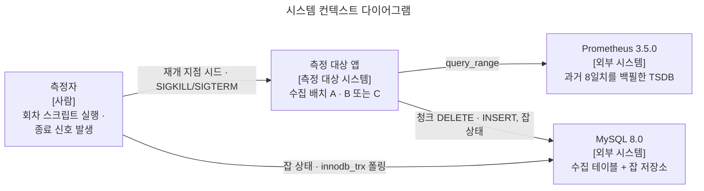

# batch-chunk-recovery-lab

5분 주기 GPU 사용량 수집 배치가 실행 중에 죽거나 긴 범위를 복구할 때, 청크 커밋 · 잡 러너 재시도 · 힙 피크가 어떻게 되는지 재현해 측정한 랩입니다.

## 요약

1절의 가설 · 판정 기준은 첫 측정보다 먼저 커밋했습니다. 아래 판정은 그 기준에 그대로 대조한 것입니다.

| 질문 | 결과 | 사전 기준 대비 |
|---|---|---|
| ① A 실행 중 종료 | SIGKILL · 쓰기 중, SIGTERM · 쓰기 중 각 1회(S224 · 3일). 두 회차 모두 진행 중 청크는 롤백되고, 재기동 뒤 JobRunr 가 잡을 FAILED → 재시도로 돌려 커밋된 마지막 시각부터 다시 읽었다. 최종 967,904행, 중복 0 · 누락 0 | 반증 조건 넷 모두 나오지 않음. 「죽어도 다음 회차가 이어서 정확히 채운다」 유지. SIGTERM 에서 예측한 「server has stopped」 FAILED 는 기록되지 않았다(잡 저장소 풀이 잡 스레드 실패보다 먼저 닫힘, 1회 관측) |
| ② A 힙 피크 | 행당 피크 힙 949.5B, 고정 비용 30.7MB(R² 0.99999). 256MB 에서 S224 는 1일부터 OOME, 768MB 에서 S224 는 4일부터 OOME | 반증 조건(행당 100B 미만, S224 · 7일 완료) 나오지 않음. 행당 값은 가설(300~400B)의 약 2.4~3.2배다 |
| ③ B 시간 창 | 7일 피크 ÷ 1일 피크가 측정한 칸 모두 1.1 이하(S896 · 1시간 창 7일은 미측정, 24시간 1.081 · 6시간 1.002 · 1시간 1.001). S896 · 7일을 256MB 에서 완료한 창은 1시간 하나. B 는 모든 회차 중복 0 · 누락 0, SIGKILL 3회도 같음 | 평평하다 · 대가 수용 · 정확 모두 충족. 상한에서 S896 을 견디는 가장 큰 창은 1시간 |
| ④ C Spring Batch | 리더 수정 뒤 재측정(측정 모드 각 2회): 피크 C ÷ B 1.124 · 1.120(차이 약 5.5MB). 신호 없는 회차 중복 0 · 누락 0. SIGKILL 1회 뒤 JobExecution 이 STARTED 로 남아 다음 주기 2번을 건너뛰었고, 사람이 FAILED 로 바꾼 뒤 다음 주기에 리더 위치부터 이어 완료. 중복 0 · 누락 0 | 메모리 동등 미충족(회차별 1.116~1.125). 초과분은 두 번째 1시간 창부터 생기는 약 5.5MB 의 일정한 기준선이고 창 안의 증가폭은 B 와 같다. 랩 리더 구현이 원인 후보(검증 전)라 Spring Batch 자체의 메모리 비용으로 읽지 않는다. 재시작 자동성은 아니요(1회)로 가설과 같음. 재시작 정확성 충족(1회) |

## 1. 목적

**5분 주기 수집 배치가 실행 중에 죽을 때 무엇이 남는지, 긴 범위를 복구할 때 어디서 메모리가 깨지는지 재현으로 판정하고, 고친 방식과 Spring Batch 를 같은 시험에 올립니다.**

| 질문 | 판정에 쓰는 비교 |
|---|---|
| ① 실행 중 강제 종료 · 정상 종료되면 무엇이 남고 어떻게 이어지는가 | 종료 신호(SIGKILL · SIGTERM) × 신호 시점(조회 중 · 청크 쓰기 중 · 청크 사이), 종료 유예 60초 |
| ② 복구 범위 × 시리즈 수에 따라 힙 피크는 어떻게 늘고, 실효 상한에서 어디서 OOM 이 나는가 **(1순위)** | 범위 1 · 2 · 4 · 7일 × 시리즈 50 · 224 · 448 · 896 |
| ③ 시간 창으로 나눠 「조회 → 커밋 → 워터마크 전진」을 반복하면 피크가 범위와 무관해지는가, 대가는 | 지금 방식(A) ↔ 창 방식(B, 1일 · 6시간 · 1시간 창) |
| ④ Spring Batch 청크 스텝으로 같은 일을 하면 피크와 재시작은 | 창 방식(B) ↔ Spring Batch(C). 읽기 전략이 같고 프레임워크와 청크를 끊는 위치가 다르다 |

### 1.1 비교군

| 기호 | 무엇 |
|---|---|
| A | 지금 방식: 재개 지점~지금 전체를 한 번 조회 → 힙에 행 목록 하나 → 500행 단위 REQUIRES_NEW 저장 (JobRunr 7.5.1 recurring 잡) |
| B | A 에서 조회만 시간 창으로 나눔. 창마다 조회 → 그 창의 행만 저장 → 커밋된 MAX(수집 시각)가 다음 창의 시작 (같은 JobRunr 잡) |
| C | Spring Batch 5.2 청크 스텝. ItemReader 가 B 와 같은 창 단위로 읽고, 아이템 = 수집 시각 하나의 행 묶음, 행 합 500 이상에서 청크를 끊는다. 재시작 상태는 ExecutionContext |

조회 · 행 변환 · 청크 쓰기 문장은 세 비교군이 같은 모듈(`lab-core`)을 씁니다. A ↔ B 는 읽기 단위만 다릅니다. B ↔ C 는 프레임워크와 함께 청크를 끊는 위치도 다릅니다(B 는 창마다 따로 저장, C 는 청크가 창 경계를 넘음).

「Spring Batch + 전체 범위를 한 번에 읽는 ItemReader」는 메모리가 A 와 같은 메커니즘이라 따로 재지 않습니다.

### 1.2 원 구성에서 옮긴 값

| # | 값 | 랩에서 |
|---|---|---|
| F1 | JVM 에 `-Xmx` · `MaxRAMPercentage` 없음, 컨테이너 메모리 상한 1Gi · CPU 상한 1, G1 명시(`-XX:+UseG1GC -XX:MaxGCPauseMillis=200 -XX:InitiatingHeapOccupancyPercent=45 -XX:ParallelGCThreads=4 -XX:ConcGCThreads=1`) → 실효 최대 힙 1Gi × 25% = 256MB | 상한 모드 기본 256MB. 768MB(`MaxRAMPercentage=75`)는 「수정 제안 수준」으로 함께 잰다 |
| F2 | Spring `RestClient` + `HttpServiceProxyFactory`. 응답을 String 으로 받지 않고 Jackson 이 바로 `record GenericResult(Map<String,String> metric, List<Object> values)` 로 역직렬화 | 같은 경로 |
| F3 | 쿼리 다섯(GPU 비율 sum by 라벨 5개 · CPU rate · 메모리는 step 1m, 파드 상태 · 생성 시각은 step 10m). 결과를 맵으로 묶은 뒤 (파드, 카드, 시각)마다 행 하나(식별자 · 문자열 4 · 값 객체 3 · long 1 · ZonedDateTime 3). 그 목록을 감사 필드를 붙여 한 번 더 복사하고 저장 단계에서 청크마다 JPA 엔티티로 바꿈 | 같은 모양. 시리즈 하나 = (파드, 카드) |
| F4 | 응답 값의 자릿수 미확인 | 짧은 값(`"87"` 꼴) · 긴 값(`"87.33333333333333"` 꼴) 두 수준 |
| F5 | 종료 유예 60초, JobRunr 종료 시 인터럽트 대기 40s, `server.shutdown` 없음 | 60초 한 수준 |
| F6 | 원천 쓰기 DB 와 JobRunr 저장소는 다른 DB. JDBC URL 옵션은 `characterEncoding` · `serverTimezone` 뿐, `hibernate.jdbc.batch_size 500` · `order_inserts true` | MySQL 하나에 스키마 둘, 데이터소스 · 트랜잭션 매니저 둘 |
| F7 | JDK 17.0.21, Spring Boot 3.5.9, JobRunr 7.5.1, MySQL 8.x | 같은 값, MySQL 8.0.46 |

### 1.3 가설과 판정 기준 (실행 전에 정함)

**① 실행 중 종료**

| 경우 | 예측 |
|---|---|
| SIGKILL · 청크 쓰기 중 | 커밋된 청크는 남고 열린 청크는 InnoDB 가 롤백한다. 잡은 PROCESSING 으로 남는다. 재기동 뒤 마지막 갱신 + 약 60초(폴링 15초 × 4)에 Orphaned 로 FAILED → 재시도 back-off 뒤 SCHEDULED → 재실행. 재실행은 커밋된 MAX(수집 시각)부터 시작하고 그 시각을 DELETE 후 다시 넣는다. 최종 중복 0, 누락 0 |
| SIGKILL · 조회 중 | 커밋 0, 이후 같음 |
| SIGKILL · 청크 사이 | 쓰기 중과 같되 롤백할 청크가 없음 |
| SIGTERM · 쓰기 중, 유예 60초 | 인터럽트가 와도 JDBC 소켓 I/O 는 멈추지 않고 청크는 계속 커밋된다. 40초 안에 끝나면 SUCCEEDED, 아니면 「server has stopped」 FAILED 뒤 커넥션 풀 종료로 진행 중 청크가 실패 · 롤백 → 재기동 뒤 재시도 |

반증 조건(하나라도 나오면 「죽어도 다음 회차가 이어서 정확히 채운다」는 틀림): 중복 1건 이상 · 누락 1건 이상 · 신호 전에 커밋 로그에 찍힌 청크의 행이 재기동 직후 사라짐 · 재기동 후 10분 안에 재실행이 시작되지 않음.

조건: A, 시리즈 224, 범위 1일. 기준 회차(신호 없음)의 쓰기 소요가 60초 미만이면 범위를 늘린다. 칸마다 3회.

**② 힙 피크 (1순위)**

- 가설: 행당 힙은 150~250B, 응답과 파싱 결과가 함께 살아 있으면 피크 기준 행당 300~400B. 7일 복구 행 수는 S=50 → 50.4만 · 224 → 225.8만 · 448 → 451.6만 · 896 → 903.2만. 그러므로 256MB 면 S=50 의 7일 복구부터 OOM 경계, 768MB 여도 S=224 의 7일 복구에서 OOM.
- 반증 조건: 행당 피크 힙이 100B 미만이거나, 실효 상한에서 S=224 · 7일이 3/3 완료. 피크가 행 수에 선형이 아니면(R² < 0.95) 「행당 힙」 하나로 말하지 않는다.
- 측정 모드(힙 넉넉히, 체크포인트에서 `System.gc()` 직후 힙 = 라이브셋)로 셀당 2회, 상한 모드(256MB · 768MB, 체크포인트 없음)로 셀당 1회, 마지막 통과 셀과 처음 실패 셀은 3회.

| 판정 | 조건 |
|---|---|
| 안전 | 상한 모드 완료(해당 회차 전부) **이고** 측정 모드 피크 라이브셋 ≤ 실효 최대 힙의 60% |
| 경계 | 완료했지만 피크 라이브셋 > 60%, 또는 GC 시간 비율 > 20% |
| 실패 | OOME 또는 종료 코드 137 이 한 회차라도 |

```
안전한 최대 복구 일수 = (실효 최대 힙 × 0.6 − 고정 비용) ÷ (행당 피크 힙 × 시리즈 수 × 1,440)
```

계산과 상한 모드 실측이 어긋나면 실측을 따르고 어긋난 이유를 OOME 스택으로 적는다.

**③ 시간 창**

- 가설: B 의 피크는 창 크기 × S 에만 비례하고 범위와 무관하다. 대가는 왕복 수 = 5 × 범위 시간 ÷ 창 시간이고, 소요 증가는 쓰기 시간보다 작다.
- 반증 조건: 같은 S · 같은 창에서 7일 피크가 1일 피크의 1.1배를 넘음.
- 변수: 창 24 · 6 · 1시간 × 범위 1 · 7일 × S 224 · 896. 측정 모드 2회 + 상한 모드 1회. B 에 SIGKILL(쓰기 중) 1칸 × 3회.

| 판정 | 조건 |
|---|---|
| 평평하다 | 창마다 7일 피크 ≤ 1일 피크 × 1.1, 그리고 S=896 · 7일이 상한 모드에서 완료. 결론은 「상한에서 S=896 을 견디는 가장 큰 창」 하나 |
| 대가 수용 | ②에서 A 가 완료한 셀에서 B 의 총 소요 ≤ A × 1.3 |
| 정확 | 중복 0 · 누락 0 (모든 회차) |

**④ Spring Batch**

- 가설: C 의 피크는 B 와 같다(±10%). 재시작은 다르다. SIGKILL 뒤 JobExecution 이 STARTED 로 남아 다음 주기가 띄우지 못하고, 사람이 상태를 FAILED 로 바꿔야 재시작된다. 재시작하면 ExecutionContext 의 리더 위치(마지막 커밋된 청크)부터 읽는다.
- 근거(Spring Batch 5.2 레퍼런스):
  - 「Advanced Metadata Usage › Aborting a Job」: "If the process died (kill -9 or server failure), the job is, of course, not running, but the JobRepository has no way of knowing because no one told it before the process died. You have to tell it manually that you know that the execution either failed or should be considered aborted (change its status to FAILED or ABANDONED). This is a business decision, and there is no way to automate it."
  - 「The Domain Language of Batch › ExecutionContext」: "the framework periodically persists the ExecutionContext at commit points. Doing so lets the ItemReader store its state in case a fatal error occurs during the run or even if the power goes out." / "The one scoped to the Step is saved at every commit point in the Step"
- 반증 조건: C 피크가 B 와 10% 넘게 다름. SIGKILL 뒤 C 가 사람 개입 없이 재시작됨.
- 변수: ③이 고른 창 하나, 범위 1 · 7일, S 224 · 896 측정 모드 2회. 재시작: SIGKILL(쓰기 중) 3회, SIGTERM(쓰기 중, 유예 60초) 3회.

| 항목 | 조건 |
|---|---|
| 메모리 동등 | C 피크 ÷ B 피크 이 0.9~1.1 |
| 재시작 자동성 | SIGKILL 뒤 사람 개입 없이 다음 주기에 이어서 실행되는가 (회차별 예 · 아니요) |
| 재시작 정확성 | 중복 0 · 누락 0 |
| 운영 부담 | 추가 메타 테이블 수, 재시작에 필요한 수동 조치 (사실 나열) |

### 1.4 설계와 달리 한 것 (실행 전에 정함)

| 무엇 | 이유 | 결과에 주는 영향 |
|---|---|---|
| ② · ③ · ④ 의 측정 모드(-Xmx6g)는 Docker VM 이 아니라 호스트 JVM(JDK 17)에서 같은 jar 를 돌린다. 상한 모드 · 종료 시험은 컨테이너(메모리 1Gi · CPU 1)에서 돌린다 | 로컬 Docker VM 이 메모리 4GB 라 6g 힙이 들어가지 않는다. 라이브셋은 컨테이너와 무관한 힙 값이다 | 측정 모드 JDK 는 17.0.15(Corretto), 상한 모드 JDK 는 17.0.21(Temurin). 객체 배치(압축 포인터)는 같아 행당 힙 차이는 작다고 보지만 확인하지 않았다 |
| C 의 JobRepository 를 원천 데이터소스 · 원천 트랜잭션 매니저에 둔다 | 청크 데이터 커밋과 ExecutionContext 갱신이 한 트랜잭션이어야 재시작 위치가 정확하다(Spring Batch 의 권장 구성) | 원 구성처럼 「잡 저장소가 다른 DB」인 Spring Batch 판은 재지 않는다 |
| ②의 16칸은 긴 값 수준으로 재고, 짧은 값은 S=224 의 네 칸만 더 잰다 | F4 미확인. 원 구성에서 「GPU 비율은 긴 소수일 것」으로 보여 보수적인 쪽을 기본으로 했다 | 실제 값이 짧으면 기본 칸의 응답 크기가 운영보다 크게 잡힌다 |

### 1.5 설계와 달리 한 것 (실행 뒤)

| 무엇 | 이유 | 결과에 주는 영향 |
|---|---|---|
| 재시작 칸(① SIGKILL · 쓰기 중, ① SIGTERM · 쓰기 중, ④ SIGKILL · 쓰기 중)을 3회가 아니라 1회 돌렸다. 결과가 예측과 어긋난 칸만 1회 더 돌리기로 했다 | 종료 뒤 동작은 JobRunr 설정과 Spring Batch JobRepository 상태가 정하는 결정적 경로다. 반복은 힙 피크 값에만 의미가 있고, 피크는 측정 모드 r1 · r2 로 이미 쟀다 | 고아 감지 시각 같은 타이밍의 분포는 말하지 못한다. ① SIGTERM 은 중간 상태가 예측과 달랐으나 이 칸에는 1회 더 돌리는 규칙을 적용하지 않았다(최종 결과는 예측과 같음, 시간 제약). FAILED 미기록은 종료 순서 경쟁에서 나온 것으로 보여, 1회로는 재현성을 말하지 못한다 |
| ① 의 범위를 1일에서 3일로 늘리고 컨테이너 메모리를 1Gi 에서 2Gi(힙 1.5GB)로 올렸다 | 1일 기준 회차의 쓰기 소요가 29초로 60초 미만이었다(1.3 의 사전 규칙). 3일 전체 조회는 768MB 힙에 들어가지 않는다(②) | ① 은 메모리 질문이 아니다. 3일 기준 회차의 쓰기 소요는 174초 |
| ① 의 조회 중 · 청크 사이 SIGKILL, 기준 회차 2 · 3회차, ④ 의 SIGTERM 칸은 돌리지 않았다 | 실행 범위를 줄인 사용자 결정 | 해당 칸의 결과는 없다 |
| ④ C 리더를 고쳐 측정 모드(S224 · 1 · 7일 각 2회)와 쓰기 중 SIGKILL 1회를 다시 돌렸다. B 는 다시 돌리지 않았다 | 첫 측정에서 신호 없는 회차에도 중복이 나왔다(1일 3,584 · 7일 25,088 = 시리즈 224 × 경계 16 · 112곳). 리더가 양 끝을 포함하는 창 조회의 경계 시각을 두 창에서 모두 내보냈다. Spring Batch 가 아니라 이 랩 리더의 결함이다. 앞 창에서 내보낸 시각은 다시 내보내지 않게 고쳤고, 수정 전 코드에서 실패하는 회귀 테스트를 더했다. 1.3 ④ 기준은 결과를 보고 바꾸지 않았다 | B 피크는 수정 전 날짜에 잰 값과 비교한다(조건은 4절). 수정 전 C 회차는 [reports/q4/invalid](reports/q4/invalid/README.md) 에 있다. S896 C 는 다시 재지 않았다. 재시작 회차는 쓰기 중 시점을 잡지 못하면 신호를 보내지 않고 무효로 끝낸다 |

## 2. 구성



구성 값과 절차의 상세는 [docs/details.md](docs/details.md) 에 있습니다.

## 3. 결과

회차별 원자료는 `reports/q1` ~ `reports/q4`, 표는 [docs/results/q2.md](docs/results/q2.md) · [docs/results/q34.md](docs/results/q34.md) 에 있습니다. 무효 회차는 각 `reports/<질문>/invalid/README.md` 에 사유와 함께 남겼습니다.

### 3.1 ① A 실행 중 종료 (S224 · 3일, 힙 1.5GB, 종료 유예 60초)

시각은 신호 기준 초입니다.

| 회차 | 신호 순간 | 커밋 · 롤백 | 잡 상태 | 재실행 | 최종 |
|---|---|---|---|---|---|
| 기준(신호 없음) | - | 1,441청크, 쓰기 174초 | SUCCEEDED | - | 967,904행, 중복 0 · 누락 0 |
| SIGKILL · 쓰기 중 | 열린 트랜잭션 1개 | 신호 직후 DB 에 마지막 커밋 로그 뒤 행 0(진행 중 청크 롤백) | 재기동 +9.5초, FAILED +70.0초(고아 감지: 메시지 `Orphaned job`, 예외 `IllegalThreadStateException`), 같은 순간 SCHEDULED(Retry 1 of 2), ENQUEUED +85.0초 | +99.7초에 마지막 커밋 시각부터 시작, +149.3초 완료 | 967,904행, 중복 0 · 누락 0 |
| SIGTERM · 쓰기 중 | 열린 트랜잭션 1개(수정 672행) | 신호 뒤 393청크가 더 커밋됨(JobRunr 40초 대기 중 310, 인터럽트 뒤 83). +52초 커넥션 풀 종료로 진행 중 청크 실패 · 롤백 | +52초 잡 서버 정지, +54초 종료 코드 143(유예 60초 전). 종료 때 FAILED 없이 PROCESSING 으로 남음. 재기동 +65.7초, FAILED +66.4초(고아 감지) → 재시도 | +96.2초에 마지막 커밋 시각부터 시작, +121.8초 완료 | 967,904행, 중복 0 · 누락 0 |

- 예측과 같은 것: 커밋된 청크는 남고 열린 청크는 롤백된다. 재실행은 커밋된 MAX(수집 시각)부터 시작한다. 인터럽트가 JDBC 쓰기를 멈추지 못한다(인터럽트 뒤 83청크 커밋). 40초 안에 끝나지 않아 커넥션 풀 종료로 진행 중 청크가 실패 · 롤백됐다.
- 예측과 다른 것: SIGTERM 회차에 「server has stopped」 FAILED 가 남지 않았고, 잡은 PROCESSING 으로 남았다가 재기동 뒤 SIGKILL 과 같은 경로로 재시도됐다. 잡 저장소 풀 종료(01:00:22.672)가 잡 스레드의 실패(38ms 뒤)보다 먼저라 FAILED 를 쓰지 못한 것으로 보인다.
- FAILED 사유 표기 `IllegalThreadStateException` 은 고아 감지가 함께 기록하는 예외 타입이다. 메시지는 `Orphaned job` 으로, 예측과 같은 경로다(③ B 의 SIGKILL 3회도 같다).
- SIGTERM 회차는 50% 지점까지 약 897초가 걸려 기준 회차(전체 174초)보다 느렸다. 원인은 확인하지 않았다. 신호 시점 조건(쓰기 중)은 충족했다.

### 3.2 ② A 힙 피크

[docs/results/q2.md](docs/results/q2.md) 를 따른다. 회귀(값 long, 회차 30개)는 행당 피크 힙 949.5B, 고정 비용 30.7MB, R² 0.99999 이다. 저장 중 증가분 (c5 − c3) ÷ 행 수는 음수(−68B)라 더하는 값은 0 이다.

| 힙 | 완료한 칸 (값 long) |
|---|---|
| 256MB | S50 · 1일(안전 37%), S50 · 2일(경계 62%). 나머지 실패 |
| 768MB | S50 · 1 · 2 · 4일(안전), S50 · 7일(경계 63%, GC 23%), S224 · 1일(안전 42%), S224 · 2일 · S448 · 1일(경계 80%). 나머지 실패 |

### 3.3 안전한 최대 복구 일수 (A, 계산식)

```
안전한 최대 복구 일수 = (실효 최대 힙 × 0.6 − 고정 비용 30.7MB) ÷ (행당 피크 힙 949.5B × 시리즈 수 × 1,440)
```

| 시리즈 | 힙 256MB | 힙 768MB |
|---|---|---|
| 50 | 1.89일 (45시간) | 6.60일 (158시간) |
| 224 | 0.42일 (10시간) | 1.47일 (35시간) |
| 448 | 0.21일 (5시간) | 0.74일 (18시간) |
| 896 | 0.11일 (3시간) | 0.37일 (9시간) |

상한 모드 실측과 대체로 맞는다. 계산이 1일 미만인 칸 가운데 256MB 의 S224 이상과 768MB 의 S896 은 1일에서 OOME 였다. 768MB 의 S448(0.74일)은 1일을 경계(80%, GC 23%)로 완료하고 2일에서 OOME 였다. 768MB 의 S224(1.47일)는 2일에서 경계, 4일에서 OOME 였다. 계산은 「피크 60% 이하」 기준이라 경계 칸의 완료와 어긋나지 않는다.

### 3.4 ③ B 시간 창

[docs/results/q34.md](docs/results/q34.md) 를 따른다.

| 창 | S224 피크 1일 → 7일 (MB) | S896 피크 1일 → 7일 (MB) | 상한 모드 S896 · 7일 |
|---|---|---|---|
| 24시간 | 322 → 348 | 1203 → 1206 | 256MB · 768MB 모두 OOME |
| 6시간 | 105 → 106 | 327 → 327 | 256MB OOME, 768MB 완료 638초 |
| 1시간 | 46 → 46 | 88 → 미측정 | 256MB 완료 644초 |

- 대가: ② 에서 A 가 완료한 셀(S224 · 1일 · 768MB)의 총 소요는 A 27초, B 1시간 창 26초(×0.97).
- SIGKILL · 쓰기 중 3회(1시간 창, S224 · 1일): 재기동 뒤 FAILED 약 68초, 재실행 263~308초에 완료, 3회 모두 중복 0 · 누락 0.

### 3.5 ④ C Spring Batch (1시간 창)

C 는 리더 수정 뒤 값, B 는 리더 수정 전 날짜에 잰 값이다(비교 조건은 4절).

| 셀 | B 피크 (MB) | C 피크 (MB) | C ÷ B | B 소요 (초) | C 소요 (초) | C 중복 · 누락 |
|---|---|---|---|---|---|---|
| S224 · 1일 | 46 | 51 | 1.124 | 121 | 102 | 0 · 0 (2회 모두) |
| S224 · 7일 | 46 | 51 | 1.120 | 843 | 667 | 0 · 0 (2회 모두) |
| S896 · 1일 | 88 | 미측정 | - | 492 | - | - |

메모리 초과분: 피크 증가분 기준 B 15.8~16.1MB · C 22.0~22.1MB 다. 창 시작 힙은 첫 창에서 C 29.1MB · B 29.4MB 로 같고, 두 번째 창부터 C 37.0MB · B 31.4MB 다. 리더가 그룹을 subList 로 버퍼에 넣어, 청크가 창 경계를 넘을 때 앞 창의 남은 그룹이 앞 창 행 목록 전체를 붙잡는 구현이 후보이며 검증 전이다. 근거는 첫 창 히스토그램에서 그룹 절반을 내보낸 뒤에도 AuditedRow 13,664개가 모두 살아 있다는 것이고, 두 번째 창 히스토그램은 없다.

S896 · 1일 C 2회는 수정 전 리더로 돌렸고 시간 상한(1,818초)에 닿아 결과가 없다. 비교값이 아니며 재측정 범위에 넣지 않았다.

SIGKILL · 쓰기 중 1회(S224 · 1일, 회차 소요 약 12.9분). 유효 회차까지 세 번 시도했다(쓰기 중에 신호가 걸리지 않은 회차 · 수정 전 리더 회차 · 이 회차). 앞의 둘은 [reports/q4/invalid](reports/q4/invalid/README.md) 에 있다.

| 시점 (신호 기준) | 무엇이 일어났나 |
|---|---|
| 0초 | 열린 트랜잭션 1개(수정 340행). 커밋 로그 374청크 |
| 신호 직후 | BATCH_JOB_EXECUTION · BATCH_STEP_EXECUTION 이 STARTED(종료 코드 UNKNOWN, COMMIT_COUNT 374). 마지막 커밋 로그 뒤 행 0(진행 중 청크 롤백) |
| +0.2초 | 정지(종료 코드 137) |
| +8.0초 | 재기동 |
| 다음 주기 2번 | `SKIP_RUNNING ... status=STARTED` 로 띄우지 않음 |
| +686.2초 | 사람의 조치: 두 실행 테이블의 STATUS 를 FAILED 로 바꿈 |
| 다음 주기(+741.5초) | 새 JobExecution 이 `restart=true` 로 마지막 커밋 시각부터 읽기 시작, +750.2초 COMPLETED(실행 8,188ms) |
| 최종 | 322,784쌍 모두 있음, 행 322,784, 중복 0 · 누락 0 |

원자료는 회차 폴더(`reports/q4/restart-batch-windowed-w1h-KILL-write-S224-D1-r3-20261123-154209`)의 `timeline.csv` · `key-lines.txt` · `after-signal.txt` · `verify.csv` 와 `reports/q4/restart-summary.csv` 다.

운영 부담(사실): 메타 테이블 6개(BATCH_JOB_INSTANCE · BATCH_JOB_EXECUTION · BATCH_JOB_EXECUTION_PARAMS · BATCH_JOB_EXECUTION_CONTEXT · BATCH_STEP_EXECUTION · BATCH_STEP_EXECUTION_CONTEXT). SIGKILL 뒤 재시작에는 두 실행 테이블의 상태를 사람이 바꾸는 조치 한 번이 필요했다.

### 3.6 사전 기준별 판정

| 질문 | 기준 | 판정 |
|---|---|---|
| ① | 반증 조건(중복 · 누락 · 커밋 행 소실 · 10분 안에 재실행 없음) | 나오지 않음(2회). 가설 유지 |
| ② | 반증 조건(행당 100B 미만 · S224 · 7일 3/3 완료 · R² < 0.95) | 나오지 않음. 가설 유지. 단 행당 값은 가설보다 크고 OOM 은 예측보다 짧은 범위에서 났다 |
| ③ | 평평하다 | 충족(창 1시간) |
| ③ | 대가 수용 | 충족(×0.97) |
| ③ | 정확 | 충족(B 회차 전부 중복 0 · 누락 0) |
| ④ | 메모리 동등(0.9~1.1) | 미충족(회차별 1.116~1.125). 초과분 약 5.5MB 는 두 번째 창부터 생기는 일정한 기준선이고 창 안의 증가폭은 B 와 같다. 랩 리더 구현이 원인 후보(검증 전, 3.5)라 Spring Batch 자체의 메모리 비용으로 읽지 않는다 |
| ④ | 재시작 자동성 | 아니요(1회, 재측정). 가설과 같음 |
| ④ | 재시작 정확성(중복 0 · 누락 0) | 충족(중복 0 · 누락 0, 1회). 기대 322,784쌍 = 행 322,784, 마지막 커밋 로그 뒤 행 0 |
| ④ | 운영 부담(사실 나열) | 메타 테이블 6개, 수동 조치 1회 |

## 4. 결론의 크기

이 랩이 보이지 않는 것을 적습니다.

- 합성 데이터와 로컬 VM(Docker 메모리 4GB) 한 대에서 잰 값이다. 운영 파드 · 운영 Prometheus 의 응답 시간과 응답 크기는 재지 않았다.
- 값 길이(F4)는 확인하지 못해 긴 값 수준을 기본으로 했다. 실제 값이 짧으면 행당 힙이 약 5% 작다(903.6B).
- 측정 모드는 호스트 JDK 17.0.15, 상한 모드는 컨테이너 JDK 17.0.21 이다. 두 JDK 의 행당 힙이 같은지는 확인하지 않았다.
- 재시작 칸은 칸마다 1회다. 경로가 설정과 상태로 정해진다는 전제에 기대며, 고아 감지 시각 · 재시도 대기의 분포는 말하지 못한다.
- ① 은 S224 · 3일 · 힙 1.5GB 에서만 쟀다. 원 구성(1Gi)과 다르고, 조회 중 · 청크 사이 SIGKILL 과 유예 30초는 재지 않았다.
- ④ 는 SIGTERM 을 재지 않았고 S896 의 C 피크가 없다. 리더 수정 뒤 재측정은 S224 두 셀과 SIGKILL 1회뿐이다. ④ 는 1시간 창 하나에서만 쟀다.
- ④ 의 B 비교값은 이틀 전 회차다(같은 호스트 · JDK 17.0.15 · 같은 JVM 설정, 공통 모듈 변경 없음). 창 1 기준선과 Prometheus 응답 크기가 C 와 같은 것으로 대조했다.
- ④ 의 메모리 초과분(약 5.5MB)은 랩 리더 구현이 원인 후보이고 검증 전이다. 원인 검증은 [리더 메모리 원인 검증 이슈(#3)](https://github.com/backend-measure-labs/batch-chunk-recovery-lab/issues/3)에서 한다.
- ④ 에서 다음 주기를 건너뛴 것은 랩 런처가 실행 중인 실행이 있으면 띄우지 않는 정책이고, 잡 파라미터(end)가 고정 시각이라 같은 JobInstance 로 이어진 결과다. end 를 지금 시각으로 두어 매 주기 새 JobInstance 가 되는 구성은 재지 않았다.
- ④ 의 소요는 부하가 있는 데스크톱 호스트에서 잰 값이라 판정에 쓰지 않는다. 7일 C 의 회차 사이 소요 편차가 약 24%(실행 758초 · 576초)다.
- C 의 JobRepository 를 원천 DB 에 둔 구성만 쟀다. 잡 저장소를 다른 DB 에 둔 Spring Batch 구성은 결과에 없다.
- S896 · 7일은 A 에서 돌리지 않았고(VM 정지), B 1시간 창의 측정 모드 피크도 없다. S896 의 1시간 창 평평함은 상한 모드 완료로만 말한다.
